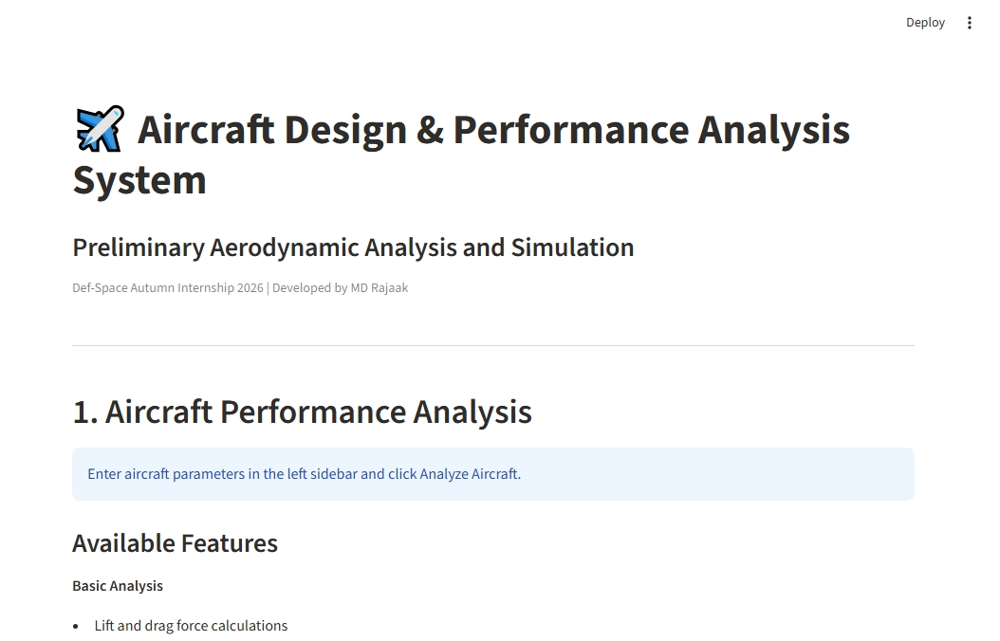
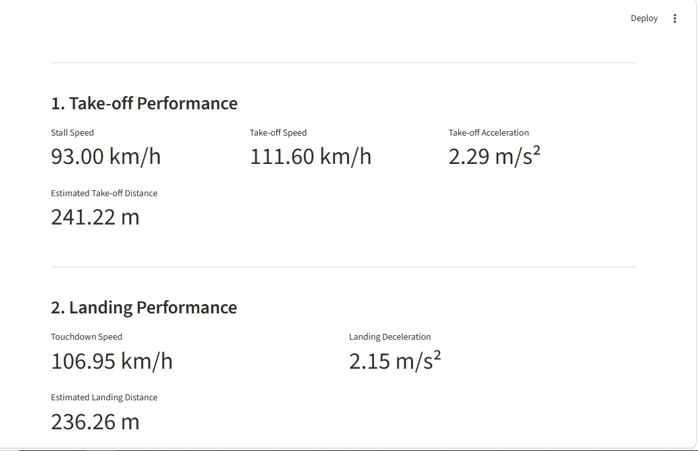
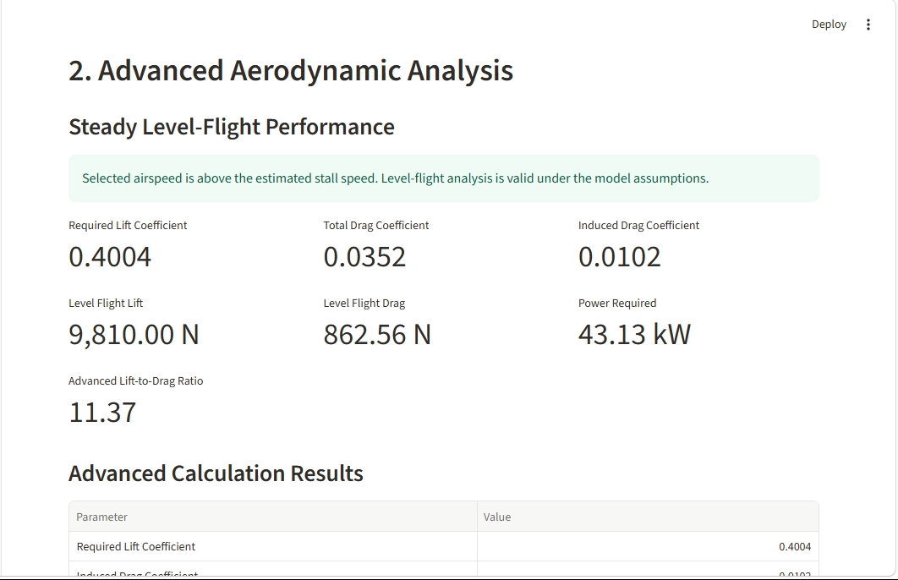
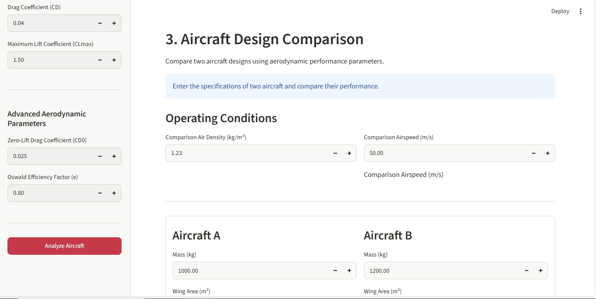
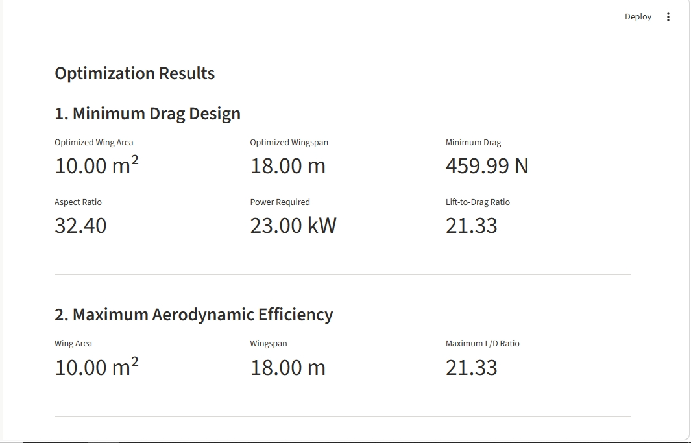

✈️ Aircraft Design & Performance Analysis System

A Python-based interactive application for preliminary aircraft
aerodynamic analysis, performance estimation, design comparison,
optimization, and geometry visualization. The application uses a
Streamlit dashboard to present engineering calculations through metrics,
tables, charts, an interactive conceptual 3D aircraft model, and
downloadable reports.

Developer: MD Rajaak
Internship: Def-Space Autumn Internship 2026
Project: Aircraft Design & Performance Analysis System

Important disclaimer: This is an educational preliminary-analysis
tool. Its simplified models and outputs are intended for learning and
research exploration only. They are not a substitute for validated
engineering analysis, computational fluid dynamics (CFD), structural
analysis, flight testing, or certified aircraft-design software. Do
not use the results for real-world flight or safety-critical
decisions.

Table of Contents
Project Overview
Objectives
Key Features
Technology Stack
Project Structure
Installation
Run the Application
How to Use
Engineering Assumptions and
Limitations
Screenshots
Future Improvements
Developer
Project Overview
The Aircraft Design & Performance Analysis System provides an
interactive environment for exploring how aircraft design parameters
influence aerodynamic forces and estimated flight performance.

Users can enter aircraft and operating-condition parameters in the
application sidebar. The system then calculates and displays selected
performance quantities and design metrics. Separate modules support
comparison of two aircraft configurations, preliminary design
optimization, flight-performance estimates, wing-geometry calculations,
and PDF report generation.

The application currently runs locally on the user's computer using
Streamlit. It is not presented as a publicly hosted web service.

Objectives
Estimate lift and drag forces for selected operating conditions.
Calculate wing loading and aspect ratio.
Estimate stall speed and selected flight-performance quantities.
Explore the influence of aerodynamic parameters on performance.
Compare two aircraft configurations using common performance
measures.
Explore feasible wing-area and wingspan combinations.
Calculate basic wing planform geometry.
Generate downloadable engineering-style reports.
Key Features
1. Aircraft Performance Analysis
Lift-force and drag-force calculations.
Wing-loading calculation.
Aspect-ratio calculation.
Stall-speed estimation.
Performance metrics and graphical presentation.
CSV export where provided by the application.
2. Advanced Aerodynamic Analysis
Required lift-coefficient estimation.
Induced-drag and total-drag estimation.
Lift-to-drag ratio.
Level-flight performance estimates.
Power-required estimation.
Aerodynamic performance graphs.
3. Aircraft Design Comparison
Side-by-side comparison of two aircraft configurations.
Comparison of mass, wing area, wingspan, and aerodynamic parameters.
Comparison of drag force and power requirement.
Comparative charts and tabular results.
4. Aircraft Design Optimization
Wing-area and wingspan design-space exploration.
Minimum-drag design estimate.
Maximum lift-to-drag-ratio design estimate.
Minimum-power design estimate.
Feasible design-configuration comparison.
Downloadable optimization data where provided by the application.
5. Flight Performance Analysis
Take-off performance estimation.
Landing performance estimation.
Climb-performance estimation.
Range and endurance estimation.
Altitude-dependent stall-speed analysis.
6. Aircraft Geometry & 3D Visualization
Wing aspect ratio.
Taper ratio.
Root-chord and tip-chord calculations.
Mean aerodynamic chord estimation.
Interactive conceptual 3D aircraft geometry model.
Downloadable geometry report.
7. Engineering Report Generator
PDF report generation.
Saved basic and advanced aerodynamic results.
Downloadable engineering-style report.
Engineering assumptions and limitations disclaimer.
Technology Stack
Technology / Library Purpose

Python Main programming language
Streamlit Interactive web application interface
NumPy Numerical calculations
Pandas Tabular data handling
Matplotlib Data visualization
Plotly Interactive charts and 3D visualization
ReportLab PDF report generation

The exact installed versions are defined in requirements.txt.

Project Structure
Aircraft-Design-and-Performance-Analysis-System/
│
├── app.py
├── calculations.py
├── comparison.py
├── optimization.py
├── flight_analysis.py
├── geometry.py
├── visualization.py
├── report_generator.py
│
├── requirements.txt
├── README.md
│
├── aircraft_performance_report.pdf
│
└── reports/
    └── screenshots/
        ├── 01-dashboard.png
        ├── 02-aerodynamic-analysis.png
        ├── 03-aircraft-comparison.png
        ├── 04-design-optimization.png
        ├── 05-flight-analysis.png
        ├── 06-geometry-3d.png
        └── 07-engineering-report.png
Note: The screenshot filenames above are suggested names for organizing
your actual application screenshots. If you keep screenshots in a
different folder, update the paths in the README accordingly. The PDF
shown in the structure is an example generated report; it may be omitted
from the repository if you prefer to keep generated outputs local.

Installation
Prerequisites
Python installed on your computer.
Git (optional, if cloning the repository).
A code editor such as Visual Studio Code.
1. Clone the repository
git clone https://github.com/Rajaak78-debug/Aircraft-Design-and-Performance-Analysis-System.git
cd Aircraft-Design-and-Performance-Analysis-System
If you have already downloaded the project, open its folder in your
terminal instead.

2. Create a virtual environment (recommended)
Windows PowerShell:

python -m venv venv
3. Activate the virtual environment
.\venv\Scripts\Activate.ps1
If PowerShell blocks activation, you can use Command Prompt:

venv\Scripts\activate.bat
4. Install dependencies
python -m pip install --upgrade pip
pip install -r requirements.txt
Run the Application
From the project directory, run:

python -m streamlit run app.py
Streamlit will display a local address in the terminal. Open the
displayed address in your browser. The default local address is usually:

http://localhost:8501
To stop the application, press Ctrl + C in the terminal.

How to Use
Start the application using the command above.
Open the local Streamlit address in your browser.
Enter the aircraft and operating-condition parameters in the
sidebar.
Select Analyze Aircraft to calculate the basic and advanced
performance results.
Explore the aircraft comparison, optimization, flight analysis, and
geometry sections.
Use the report-generation section to create and download the
available PDF report.
Change the input parameters and run the analysis again to explore
different design cases.
The available inputs and outputs depend on the selected module and the
parameters shown in the application.

Engineering Assumptions and Limitations
The application uses simplified preliminary aerodynamic models.
Depending on the calculation, these may include:

Steady and level-flight assumptions where applicable.
Constant air density for selected operating conditions.
A parabolic drag-polar approximation.
Induced-drag estimation using aspect ratio and Oswald efficiency.
Simplified take-off, landing, climb, range, and endurance
calculations.
An ISA tropospheric density approximation for altitude-related
calculations.
A conceptual 3D aircraft model rather than a detailed CAD or
structural model.
Actual aircraft performance depends on many additional factors,
including configuration, propulsion characteristics, Reynolds number,
compressibility, atmospheric conditions, stability, control, structural
limits, and validated aerodynamic data. These factors are not fully
represented by this educational application.

Use the outputs for educational exploration only. They must not be
used as the sole basis for aircraft construction, operation, flight
planning, or safety-critical decisions.

Screenshots
Add genuine screenshots captured from your running application to the
reports/screenshots/ folder. Then the images can be displayed here.

When the screenshots have been uploaded to GitHub at the paths below,
uncomment or retain these image links:

Screenshot What it demonstrates

01-dashboard.png Main dashboard and input parameters

02-aerodynamic-analysis.png Basic and advanced aerodynamic
analysis

03-aircraft-comparison.png Comparison of two aircraft
configurations

04-design-optimization.png Optimization results and
design-space analysis

05-flight-analysis.png Flight-performance analysis

06-geometry-3d.png Wing geometry and conceptual 3D
model

07-engineering-report.png PDF report-generation interface
Example Markdown image syntax:

Future Improvements
Potential future development areas include:

More detailed aerodynamic models and validation against reference
data.
Additional aircraft configurations and wing-planform options.
Expanded propulsion and mission-performance models.
More detailed geometry export and CAD interoperability.
Improved input validation and automated testing.
Optional cloud deployment for remote access.
These are possible future enhancements and are not claims of features
already implemented.

Developer
MD Rajaak
B.Tech -- Electronics and Communication Engineering
Central University of Karnataka
Def-Space Autumn Internship 2026

GitHub Repository:
https://github.com/Rajaak78-debug/Aircraft-Design-and-Performance-Analysis-System

Developed as an educational aircraft-design and performance-analysis
project during the Def-Space Autumn Internship 2026.

## 📸 Application Screenshots

### 1. Main Dashboard

### 2. Aircraft Performance Analysis

### 3. Advanced Aerodynamic Analysis

### 4. Aircraft Design Comparison

### 5. Design Optimization

### 6. 3D Aircraft Geometry

### 7. Engineering Report
[View Sample Engineering PDF Report](screenshots/Aircraft_Performance_Report%20(2).pdf)

